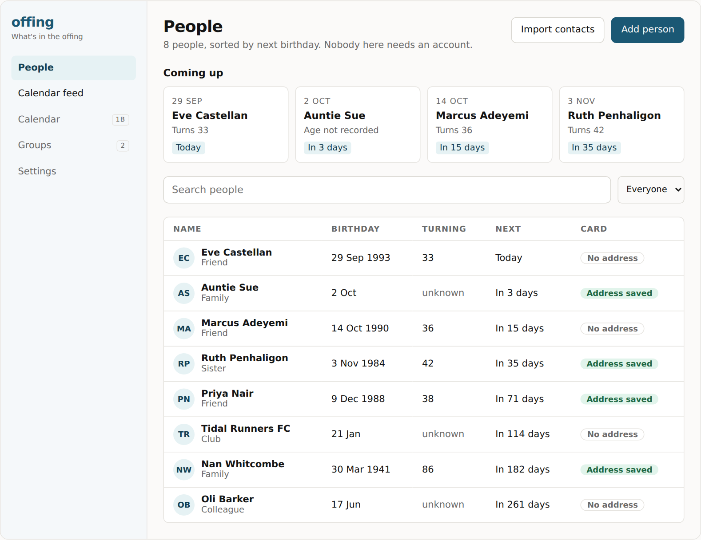
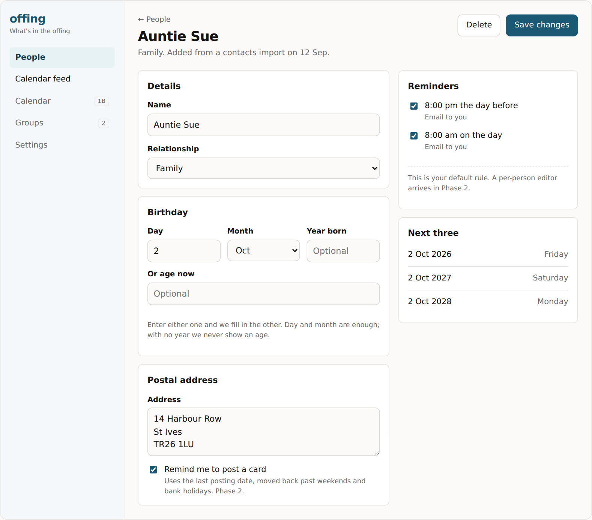
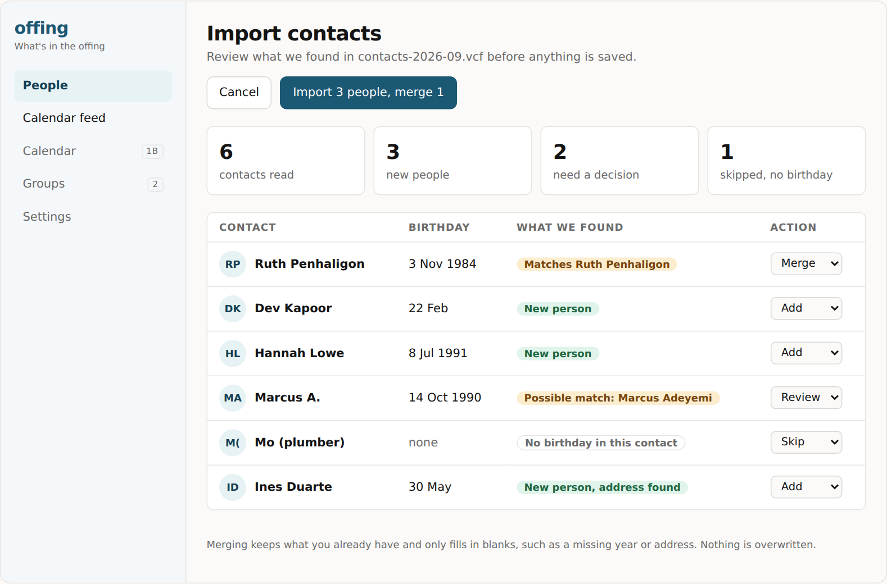

# offing.uk
A shared calendar for the people in your life — partners, friends, and clubs, each seeing exactly what they should. Open source, self-hosted, PHP/Laravel.

## Status: first UI prototype

Offing is at the design stage. The first UI prototype is a set of clickable mockups for the Phase 1a "Birthday Engine" screens: the people list, a person page, vCard import review and the calendar feed link. It uses made-up example data and nothing is saved.

**[Open the prototype](https://claude.ai/artifact/AgG4jCyyTtggxEG5FSVZJc)**

| Person page | vCard import review |
| --- | --- |
|  |  |

The screenshots are rendered without the Instrument Sans web font, so type looks slightly different from the live prototype.
